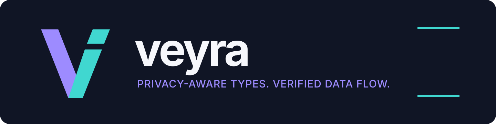

# Veyra



Veyra is a statically typed, general-purpose language implemented in safe Rust.
It has its own UTF-8 lexer, parser, AST, semantic checker, tree interpreter,
bytecode compiler, validated `.vyb` format, stack VM, module loader, and CLI. Its
distinctive feature is policy-aware data flow: confidentiality labels follow
values through expressions, calls, modules, branches, and loops before code is
allowed to reach a protected output boundary.

This repository is an executable language implementation, not a claim of
complete privacy or universal noninterference. The current checker protects
console and file output, rejects implicit control-flow leaks, and has no label
downgrade operation. Capability-authorized release and additional trusted sinks
remain future work. Read [the security model](SECURITY_MODEL.md) and
[the limitations](docs/LIMITATIONS.md) before relying on it.

## Install and use

Install stable Rust 1.85 or newer, then from this repository run:

```sh
cargo install --path crates/veyra-cli
veyra --version
```

Create `hello.vy`:

```veyra
fn main() {
    let name = "World";
    println("Hello, " + name);
}
```

Check, run, and compile it:

```sh
veyra check hello.vy
veyra run hello.vy
veyra run --interpreter hello.vy
veyra build hello.vy -o hello.vyb
veyra run hello.vyb
```

`veyra run` checks the source, emits bytecode, validates it, and runs the VM.
`--interpreter` selects the independent reference interpreter. During repository
development, replace `veyra` with `cargo run -q -p veyra-cli --`.

## Privacy-aware data flow

```veyra
policy HospitalPrivate {
    owner: "hospital-a";
    export: deny;
}

fn main() {
    let secret = private<HospitalPrivate>(85);
    let derived = secret + 15;
    println(derived);       // rejected: explicit protected flow

    if secret > 80 {
        println("high");   // rejected: protected control flow
    }
}
```

The diagnostic names the originating policy, the public destination, and whether
the effect is control-dependent. Protected computation is permitted while its
result remains protected. `release(...)` is not a built-in and ordinary code
cannot remove a label.

Try the checked examples:

```sh
veyra check examples/privacy/safe_computation.vy
veyra check examples/privacy/blocked_leaks.vy
veyra check examples/privacy/implicit_flow_blocked.vy
```

The final two commands are expected to fail compilation.

## Multi-file program

`import math;` loads the sibling `math.vy` and exposes its `pub` functions:

```sh
veyra check examples/modules/main.vy
veyra run examples/modules/main.vy
# 49
```

See [the user guide](docs/USER_GUIDE.md) for variables, functions, scopes,
arrays, structs, loops, modules, built-ins, bytecode, and every command.

## CLI

```text
veyra eval "2 + 3 * (4 - 1)"
veyra run program.vy
veyra run --interpreter program.vy
veyra check program.vy
veyra build program.vy -o program.vyb
veyra run program.vyb
veyra disasm program.vy
veyra repl
veyra fmt program.vy
```

## Architecture

```text
.vy source -> lexer -> parser -> AST -> name/type checker -> policy-flow checker
                                                   |                 |
                                                   v                 v
                                         reference interpreter   bytecode compiler
                                                                      |
                                                               validator -> VM
```

The policy-flow gate runs before either execution engine. The interpreter and VM
are tested against one another on the same programs. Detailed crate boundaries
and the trusted computing base are in [ARCHITECTURE.md](ARCHITECTURE.md).

## Honest feature matrix

| Area | Status |
|---|---|
| Lexer, parser, AST, static typing, local inference | Implemented |
| Immutable-by-default bindings and lexical scopes | Implemented |
| Functions, recursion, branches, loops | Implemented |
| Arrays, structs, strings, sibling-file modules | Implemented |
| Reference interpreter and validated bytecode VM | Implemented |
| Named confidentiality policies and expression propagation | Implemented |
| Program-counter labels for `if`, `while`, and `for` | Implemented, conservative |
| Call/return and cross-module label propagation | Implemented by call-site analysis |
| Protected console and file-write sinks | Implemented |
| Error-path checks for division/remainder and indexing | Implemented, conservative |
| Capability-authorized release and audit log | Not implemented; downgrade is rejected |
| HTTP, database, log, serialization, and native-FFI sink adapters | Not implemented |
| Generics, closures, async, packages, native-code generation | Not implemented |

## Verification and project records

```sh
cargo fmt --check
cargo clippy --workspace --all-targets -- -D warnings
cargo test --workspace
```

CI runs the same gates. Positive and negative compilation fixtures are under
[`tests/fixtures/`](tests/fixtures/); CLI integration tests verify the required
rejections and interpreter/VM agreement. See the
[completion report](COMPLETION_REPORT.md), [release checklist](docs/RELEASE_CHECKLIST.md),
[language specification](LANGUAGE_SPEC.md), [policy semantics](POLICY_SEMANTICS.md),
[threat model](THREAT_MODEL.md), and [research context](DIFFERENTIATION.md).

The original SVG identity assets and usage rules live in
[`assets/brand/`](assets/brand/).
